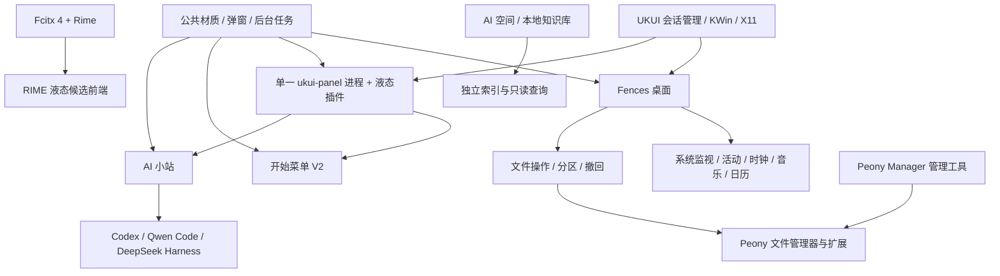

# UKUI 液态桌面：完整框架与整改现状

## 2026-10-30 源码统一与框架监视

当前开发总目录已迁至 `/home/zhouzhang/应用/LiquidDesktop`。本文既有路径的旧位置均保留兼容链接。24 个源码/依赖树迁移及清理候选、进程状态、登录路线见 [整理记录](FRAMEWORK_WORKSPACE_20261030.md)。


更新：2026-10-30。依据当前源码、用户会话进程、D-Bus 入口、配置与隔离测试核对。主仓库发布基线仍为 v0.7.0；本文包含其后的工作区改造，不把历史版本文档当作当前实现。

[项目主页](../README.md) · [构建](BUILD.md) · [安装与恢复](INSTALL_AND_RESTORE.md) · [机器可读组件清单](../integration/components.json)

## 1. 整体结构

这套系统已经具备“桌面呈现、应用启动、任务切换、输入、文件集成、AI 入口”的完整组合。它保留 UKUI 的会话管理、KWin 和输入引擎，在相应边界替换界面或接管入口。不同组件的替换程度需要分别判断。



可持续的框架分为六层：

| 层 | 当前职责 | 约束 |
|---|---|---|
| 会话与平台 | UKUI 会话、KWin、X11、Fcitx 引擎 | 不把 UI 改造等同于重写窗口管理器或输入引擎 |
| 桌面与 Shell | Fences、任务栏插件、开始菜单 | 每种入口保持一个所有者；避免重复桌面和透明输入覆盖 |
| 领域模型 | 文件操作、应用注册表、活动账本、系统采样、聊天会话 | 数据模型与绘制分开，不能用显示文本充当状态源 |
| 后台执行 | 文件任务、采样、CLI 会话、索引、外部辅助程序 | 有界并发、取消、退出回收；界面不承担重型采集 |
| 公共呈现 | 液态材质、弹窗、字体与图标、DPI、悬停和动画 | 缓存材质，数据变化只更新内容；静止后停止帧驱动 |
| 配置与恢复 | Fences 设置、组件偏好、版本迁移、安装备份、接管守护 | 显示状态、记录开关和随登录启动分开；每项新功能都要有保存及恢复入口 |

## 2. 我们实际维护的组件

| 组件 / 源码 | 当前实现与进程边界 | 设置与数据 |
|---|---|---|
| `apps/ukui-fences` | 自绘 DesktopCanvas、分区、文件图标、拖放、剪贴板、撤回、壁纸；五类组件共用一个进程 | `~/.config/kylin/ukui-fences.conf`、`~/.config/kyfences/layout.json`；Fences 设置统一入口 |
| 系统监视 | Fences 子控件，后台读 `/proc`；CPU、内存、磁盘、进程排行与本地快照 | Fences → 系统监视；显示/自启动在桌面小组件页 |
| 活动统计 | Fences 内的 ActivityRecorder + ProcessMetrics；前台时间与资源采样分离 | schema v2 的 `activity.json`、日期 JSONL；Fences → 活动统计 |
| 时钟、音乐、日历 | LiquidDesklet 统一材质、位置、拖动与保存；MPRIS 和本地日历适配 | Fences 相应专项页；倒计时操作留在组件本体 |
| `apps/ukui-panel-liquid` | QStylePlugin 加载到原生 `/usr/bin/ukui-panel`，复用任务区、托盘、日历与原生按钮 | `~/.config/ukui/liquid-panel.ini`；液态材质 / 布局交互 / 窗口动画三页 |
| `apps/ukui-kaishicaidan-v2` | 独立菜单进程接管 `org.ukui.menu`；搜索、固定、最近、系统入口和短按 Super 键 | `~/.config/ukui-kaishicaidan-v2/`；原生按钮接入可用时关闭透明覆盖层及其窗口监听 |
| `../liquid-cli` | 独立 AI 小站；按需启动 CLI，后台分别保存会话和草稿 | `~/.config/liquid-cli/settings.json`；任务栏 AI 小球右键设置 |
| `../fcitx-liquid-panel` | Fcitx 4 Kimpanel 候选前端；Rime 仍承担输入与词库 | `~/.config/fcitx/liquid-panel.conf`；输入法托盘设置 |
| `../fcitx-liquid-lite` | 无常驻进程的 Classic UI 轻量皮肤，作为前端回退 | Fcitx 皮肤配置；不是第二套输入引擎 |
| `../../peony-manager` | 按需运行的 PyQt5 + 本地 WebEngine 管理器；插件装入 Peony，不常驻额外管理服务 | GSettings `org.ukui.peony.settings`、`~/.config/peony-manager/cli-profiles.json` |
| Peony 自有插件 | 复制路径、CLI 侧栏等；CLI 模块按需加载，会话使用独立 scope | 管理器中的插件和 CLI 配置；安装系统插件走专用授权 helper |
| `../ai-space` | 已拆分的本地检索/知识库应用，独立索引与工作进程 | 独立项目管理配置和数据库；Fences 不再内置扫描/OCR |
| `integration/peony` | 可选、事件驱动的普通窗口模糊兼容服务 | 只处理列明的应用与窗口类型，不承担桌面管理 |
| `extras/ukui-desktop-performance` | 特定 FTG340 硬件的可选频率策略；独立系统级扩展 | 需要管理员安装，不是通用优化；本轮未改驱动、频率或电源策略 |
| `integration/session` | 有时限的桌面接管与自动恢复工具 | Fences → 桌面接管（实验）；当前不更改登录 provider |

`ukui-desktop-organizer` 等历史原型、系统偏好脚本和研究 checkout 不应被误认作当前运行的 Shell。清单只定位它们的关系，不删除旧工程或用户备份。

## 3. 今晚完成的整改

### 任务栏与开始入口

- Dock 应用图标自适应，拥挤时一个“⋯”入口；横移逐图标平滑追随，采用稳定图标位图和浮点缩放，静止后停止计时器。
- 温度、上下行带宽、日期组合圈及两端小球保持原布局。屏幕右下角显示桌面为原颜色细竖线。
- 清透、柔和、磨砂三类材质参考 NextKde。取消宽反光和重复左上角焦散，细边高光不再超范围放大。设置可分别控制反光与鼠标追光。
- `PanelLauncherBridge` 与开始菜单的 `StartButton` 通过能力服务协作：使用真实开始按钮，直接区分鼠标与 Super 键请求，保留右键菜单；面板能力消失时有旧方案回退，不留下不可见点击层。
- AI 小站清空确认窗按换行高度排版，窗口与下拉列表受可用屏幕约束。

### 系统监视

删除 DeepSeek/API 诊断、模型获取、密钥环读取与诊断对话框，换成本地资源概况、较宽的进程表、CPU/RSS 排序和只读快照。首次进程采样没有基线时显示“—”；CPU 按单核 100% 计，修复多核进程被截到 100% 的问题；PID 复用不沿用旧计数。旧凭据不读取、不迁移到新功能，也不擅自擦除。

### 今日应用

此前已有本地时长记录，本机核对时为 33 天、约 39 KB 的 schema v1 账本。升级前保存备份，继续保留原时长。

新版本提供：前五应用的进程组 CPU/RSS、均值、采样峰值、1 秒悬停、日期与应用筛选、CSV 和指标日志。默认 10 秒异步采样、每分钟批量落盘；日汇总 60 天，详细日志默认 7 天。锁屏或暂停停止采样，PID 更换、休眠与过长间隔重建基线。均值仅覆盖有效采样时段，RSS 共享页可能重复，旧历史不补造资源数据。

## 4. 完全替换与实际资源结论

| 部位 | 当前事实 | 本轮结论 |
|---|---|---|
| 桌面 | 常规模式下 Fences 与 Peony 桌面同时驻留 | 已证明可临时让 Fences 单独承担桌面，Peony 桌面进程实际退出；不是仅把它藏起来 |
| 任务栏 | 只有一个 ukui-panel，改造在其进程内 | 没有第二套 Panel 可以简单“关闭省一份”；完全重写需重新承担任务、托盘、预览及会话接口 |
| 开始菜单 | V2 已取得原菜单服务名；旧方案另有透明按钮窗口 | 新接入消除透明按钮及其跟踪连接，菜单进程继续承担搜索与启动，不能声称省掉整个菜单进程 |
| 输入法 | 引擎与候选前端职责不同 | 保留 Fcitx/Rime；不能关闭引擎来消除“重复” |
| 文件管理器 | 桌面窗口与普通文管可能同进程，也可能分离 | 接管工具遇到目标进程承载非桌面窗口时拒绝停止，避免关闭文件窗口和 CLI 会话 |

接管验证包括隔离 X11/会话总线中的真实 Peony、Fences、KWin，以及本机 15 秒试运行。已验证超时、Fences 退出、Fences 隐藏三条恢复路径，及拒绝结束承载普通窗口的桌面进程。本机试运行期间原生桌面进程数为 0，Fences PID 不变，结束后 Peony 恢复，`org.ukui.session.required-components filemanager` 仍为 `peony-desktop`。

资源数字必须同时看驻留和换出：本机早期短样本 Peony 桌面约 21 MiB PSS，实机试验前约 18.6 MiB PSS，试验守护约 9.6 MiB。恢复后的新进程可能比长期闲置、已换出的旧进程有更高 PSS；不能据一次重启把这些差异归为内存泄漏或固定节省量。读取 `/proc/<pid>/smaps_rollup` 的 PSS 与 SwapPSS，比直接相加 RSS 更适合当前评估。当前仅有短时样本，尚无整晚稳定负载基准。

当前提供的是**有界实验接管**，未默认永久更换登录桌面。正式生产接管还需要登录/注销、锁屏恢复、多屏、Fences 崩溃和升级回退的完整会话验收；KWin、会话管理和输入引擎仍应保留。

## 5. 配置、数据与外部调用契约

| 功能 | 保存与恢复 | 外部调用 |
|---|---|---|
| 文件与分区 | 布局、操作撤回记录、原子配置 | 用户目标文件上的 GIO/本地操作 |
| 系统监视 | 外观、采样、排序、紧凑状态；快照由用户导出 | 不连接模型服务 |
| 活动记录 | 版本 1→2 先备份；原子汇总、私有 JSONL、按天保留 | 不读取标题、文档内容、命令参数或输入 |
| AI 小站 | 后台隔离的记录与草稿；恢复原会话 | 发送消息后由所选 CLI 与模型服务交互；Qwen/DeepSeek 本轮不声称真实账号联调通过 |
| AI 空间 | 独立快照与 SQLite/FTS；只读查询不等同建库 | 默认本地；显式 Provider 才接外部程序或服务 |
| 音乐与日历 | 客户端配置、倒计时和节假日缓存 | MPRIS、封面下载；系统待办按操作写回，完成状态本地保存；节假日手动同步 |
| Peony 插件管理 | 插件/CLI 配置、安装前备份 | 需要系统安装时专用 polkit helper；管理 GUI 不整体提权 |
| 桌面接管 | 显示会话绑定、PID/启动时间校验、到时恢复 | 仅目标用户的原生桌面进程；不使用 `peony -q` 批量关闭文管 |

Fences 设置已接入系统监视新字段、活动记录/资源间隔/日志保留/历史入口、实验接管与恢复。新增功能的完成标准包含：入口、字段、默认值、应用、重启恢复、隐藏/暂停语义、失败提示和测试，不只检查“页面上有按钮”。

## 6. 共享代码与后续优化

目前主仓库的 `shared/liquid-popup`、`shared/liquid-glass`、`shared/async-work` 供三个主应用使用，AI 小站也直接引用主仓库源码。静态链接意味着每个宿主必须重新构建和安装才会更新，不能只改一份文件就认为所有运行实例同步。

液态输入法仍引用工作区 `../shared` 的另一份源码，AI 空间维护独立快照；这是后续最容易产生修复不同步的地方。Fences 的分区/系统监视另有 FenceGlassRenderer 适配层，并非所有表面已完全共用同一渲染实现。

输入法托盘菜单在打开时还会读取任务栏 INI 中的高光与减少动效设置。这属于现有的隐式配置耦合，尚不是一个统一的跨进程主题协议；调整字段时需要保持兼容。

AI 小站也会把 Peony CLI 配置中的命令作为未显式配置时的默认来源，再由自己的 `settings.json` 覆盖；不回写 Peony 配置。这些初始化关系应纳入后续的配置兼容测试。

| 优先级 | 优化项 | 可检验的完成标准 |
|---|---|---|
| 高 | 正式桌面 provider 与登录恢复 | 完整会话矩阵通过后才可提供持久接管；异常时原生桌面自动回来 |
| 高 | 统一进程采样服务 | 系统监视与活动统计共享带时间戳、PID 起始时间的快照；不增加后台服务或重复全量扫描 |
| 高 | 安装事务统一 | Fences/开始菜单逐步采用版本目录与原子切换，像 AI 小站一样保留可恢复版本；失败自动还原 |
| 中 | 公共材质和弹窗单一来源 | 先做像素、DPI、键盘、生命周期对照，再切换输入法与 AI 空间的依赖，避免直接覆盖副本 |
| 中 | 内存预算 | 在稳定负载下记录 PSS+SwapPSS、壁纸解码尺寸和缓存峰值；限制超高分辨率源图与重复快照 |
| 中 | 统一外观语义 | 共享“清透/柔和/磨砂、文字对比、减少动效”等语义，不强行让不同表面使用同一组原始 shader 数值 |
| 中 | 完整运维可观测性 | 统一构建来源、版本、日志目录、启动/退出状态；日志有上限与保留策略 |
| 后续 | 多屏与 Wayland | 本轮目标仍为 UKUI X11；Wayland 需重新适配窗口/托盘/输入协议，不能视为已支持 |

## 7. 可运行的框架入口

只读检查当前组件、配置位置、D-Bus 与前端进程内存，不启动应用：

```sh
/usr/bin/python3 integration/desktop_status.py
/usr/bin/python3 integration/desktop_status.py --json --output /tmp/liquid-desktop-status.json
```

接管试验和恢复入口见 [会话实验说明](../integration/session/README.md)。产品与模型边界见各组件 README。测试结果见 [验证记录](VALIDATION.md)；原始记录在本次构建产物 `apps/ukui-panel-liquid/build/artifacts/overnight-20261030/`。

上游参考固定为 [NextKde 3fa1d700](https://github.com/NextKde/NextKde/tree/3fa1d7006869bbd3404a05d362c6e6028e0fe3da)：`DockWindow.qml`、`AppearanceConfigService.qml`、`LiquidGlassSurface.qml`、`MetricsService.qml`、`ActivityUsageService.qml` 与 Dock 数学模块。我们在 Qt5/UKUI 下适配其设计和部分算法，没有移植整个 Qt6/Quickshell/Go/Wayland 运行时。
