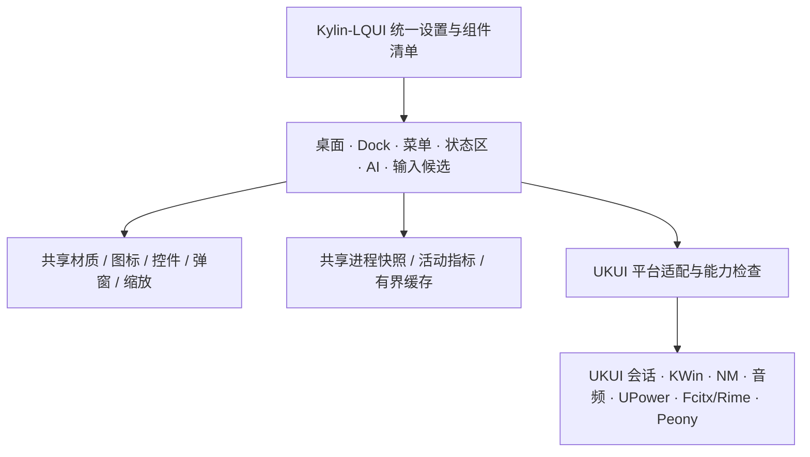

# Kylin-LQUI：统一 UI 与原生接管评估

更新：2026-10-30。产品名称统一为 **Kylin-LQUI**。定位是面向国产化硬件的桌面视觉与交互系统：保留 UKUI 的会话、合成器、输入引擎与系统服务，逐步接管可见的桌面、任务栏、开始菜单、弹窗、状态区与设置。不是另装一套完整 KDE，也不是卸载 UKUI。

本轮包含可运行修复与框架整理；完整控制中心和永久登录接管仍属于下面列明的后续阶段，不把设计稿当成已完成能力。

## 1. 对照依据与适配边界

本次核对 NextKde 官方 main 固定提交 [3ad2152512d29e3b704c5da8c2d4e96ebb12e722](https://github.com/NextKde/NextKde/tree/3ad2152512d29e3b704c5da8c2d4e96ebb12e722)。主要参考：

- [总体架构](https://github.com/NextKde/NextKde/blob/3ad2152512d29e3b704c5da8c2d4e96ebb12e722/docs/ProjectArchitecture.md)：界面、平台接入与数据服务分层。
- [统一设置](https://github.com/NextKde/NextKde/blob/3ad2152512d29e3b704c5da8c2d4e96ebb12e722/apps/settings/README.md)及 [页面目录](https://github.com/NextKde/NextKde/tree/3ad2152512d29e3b704c5da8c2d4e96ebb12e722/apps/settings/pages)：一致的设置行、导航、控件和集成状态。
- [平台接口](https://github.com/NextKde/NextKde/blob/3ad2152512d29e3b704c5da8c2d4e96ebb12e722/docs/PlatformArchitecture.md)：网络、音频、电源、显示与通知通过明确接口接入。
- [数据服务](https://github.com/NextKde/NextKde/blob/3ad2152512d29e3b704c5da8c2d4e96ebb12e722/docs/DataServiceArchitecture.md)：指标、应用活动和持久化共享状态。
- [接管与安装](https://github.com/NextKde/NextKde/blob/3ad2152512d29e3b704c5da8c2d4e96ebb12e722/docs/GettingStarted.zh-CN.md)：其桌面接管仍保留 Plasma 的壁纸承载，部署和回退有明确边界。

NextKde 面向 Plasma 6 Wayland、KWin 6.6+、Qt 6.6+ 与 Quickshell；本机是 aarch64 / Phytium-D3000M HL8-C / Qt 5.12.8 / UKUI X11。KWin 实测使用 Phytium FTG340、GLX、OpenGL 4.6 V1.1.7，当前走 OpenGL 2 shader 路径；这不代表其他显卡或驱动版本已经通过验证。应借鉴设置契约、数据分工、生命周期和布局算法，不能直接移植其 KWin 插件或照搬硬件/服务依赖。

## 2. 我们已有的原生接入

| 层 | 当前实际方式 | 接下来 |
|---|---|---|
| 桌面与小组件 | Fences 独立桌面窗口；正常登录仍有 Peony 桌面 | 正式桌面 provider 后只保留一个桌面表面，Peony 作为回退 |
| 任务栏、Dock、托盘 | 在原生 ukui-panel 进程内加载样式与适配组件 | 保留任务、托盘与通知协议，逐步替换外观和弹窗 |
| 开始菜单 | 原生开始按钮桥接到 V2 菜单，Super 路径保留 | 不再叠加透明点击层；统一应用图标和视觉 |
| AI 小站 | 独立本地 GUI，后台 CLI 按需连接 | GUI 登录常驻与预热，后台休眠独立配置 |
| 输入法 | Fcitx/Rime 引擎 + 液态候选前端 | 不替换词库/输入引擎；统一候选设置与材质协议 |
| 文件管理 | Peony + 按需管理器及插件 | 扩展与命令配置统一入口，文件操作仍交给既有服务 |
| 通知、网络、电源、音量 | 当前主要使用 UKUI 原生组件 | 分步统一状态区与控制面板，保留原系统后台 |

任务栏已经不是“第二个 panel 覆盖上去”；真正仍重复的主要是常规模式下的两个桌面承载。解决资源重复，应针对组件归属，不能笼统结束所有 UKUI 进程。



## 3. 设置体系差距

“已具备”指有可运行能力；“部分”指目前分散或未统一，并不等于已经完成全局设置。

| 设置域 | NextKde 的组织方式 | Kylin-LQUI 当前情况 | 优先补齐 |
|---|---|---|---|
| 主题、明暗、色彩 | 共享外观快照与控件语义 | 材质已共享，配置仍分散 | 一份全局语义配置、版本与模块覆盖规则 |
| 玻璃与低成本外观 | 液态/柔光/磨砂/Material | panel 已有三预设，其他宿主参数不同 | 统一预设名，按能力降级；保留模块微调 |
| 图标 | 集中解析、模板与缓存 | 原图透明边距造成大小不一 | 本轮统一光学尺寸；菜单去除常驻外框 |
| 桌面与文件 | 桌面布局/文件状态分离 | Fences 已有文件、分区、小组件 | 接管归属、跨屏/缩放验收 |
| 壁纸 | 独立库、缩略图与适配 | Fences 壁纸与液态取色可用 | 限制解码尺寸、统一缓存失效，不重复保存大图 |
| Dock / 任务栏 | 专门的布局与交互设置 | 自适应、溢出、菜单、角落显示桌面已接入 | 修正原生 realign 与自适应单元格争用 |
| 开始菜单 | 启动器专页 | V2 独立设置 | 纳入统一导航、图标和搜索设置 |
| 显示 | 分屏、缩放、亮度 | 主要依赖 UKUI | 统一入口，写入仍通过已有系统能力 |
| 快捷键 | 集中管理与冲突反馈 | 各模块与系统快捷键并存 | 列出有效绑定、冲突与归属 |
| 窗口动画 | 受能力检查约束 | 已有可回退试用与特效页 | 不强制切换 OpenGL，不按 CPU 品牌猜 GPU 能力 |
| 通知 | 勿扰、预览、历史、应用策略 | 仍使用原生通知服务 | 新通知前端/协议接管、历史与通知权限契约 |
| 网络 / 音频 / 电池 | Control Center + 平台接口 | 原生服务运行，视觉分散 | 四状态组合区，再统一弹窗 |
| 组件与服务 | 启用/状态/扩展入口 | 已有进程表与独立工具 | 区分进程存在、D-Bus 可用、业务就绪 |
| 性能与调度 | 单独资源设置 | 有采样节流、缓存和可选性能工具 | 默认不改系统调度策略；先做能力档位与测量 |
| 诊断/集成 | 明确显示接管者与错误 | 进程表、短时接管状态已具备 | 版本来源、服务归属、失败原因与恢复入口 |
| 更新与回退 | 统一运维入口 | AI 版本目录；其他组件安装方式不同 | 统一 release 清单、原子切换、兼容检查和恢复 |
| 无障碍 | 仍在持续完善 | 键盘、DPI、对比已有部分测试 | 全局减少动态效果、清晰模式、键盘焦点与读屏标签 |

统一设置不应把所有参数挤进一个长滚动页：建议主导航为“总览、外观、桌面、任务栏、开始菜单、控制中心、窗口、输入法、AI 小站、组件、维护”，系统级管理有明确的“打开 UKUI 设置”入口。

## 4. 右侧四功能的组合建议

建议合并为一个轻薄的 **系统状态组**，但保留四个独立点击区域。第一步统一底板、图标基线和反馈；第二步再用同一个控制面板承接功能。不要为了画框把四个原生插件重排到会破坏生命周期的新容器。

```text
[麒麟球] [应用 Dock] [输入法 / 隐藏托盘] [网络  音量  电池  通知] [温度 / 带宽 / 日期] [AI 球]
                                            系统状态组          现有组合圈保留
```

- 底板只渲染一次；内部不再套四个小玻璃框。指针移入只突出当前图标。
- 网络可保留断网/连接中标记；音量保留静音；电池保留充电/低电状态；通知保留未读点。
- 主点击打开控制中心并定位对应区域，右键提供该项的详细设置。通知区域不会因为另外三项的刷新而重建。
- 无电池设备隐藏电池图标或显示电源模式；无 Wi-Fi 保留有线状态。不显示没有后端支持的假开关。
- 网络继续使用本机 NetworkManager；电池用 UPower；音频按现有 PulseAudio/PipeWire 能力适配，不安装替代声卡后台。通知是独占 D-Bus 接管项，单独验收。
- 当前已确认 NetworkManager、UPower、BlueZ、Notifications 名称在本机会话/系统总线上存在；这只证明服务存在，不代表所有设备功能已经联调。

本轮提供上述设计结论，未把四个原生功能强行替换成尚未实现的控制中心。温度、带宽、日期组合圈保持原布局。

## 5. 原生桌面接管的推荐方式

结论：可行，采用 **新增 Kylin-LQUI 登录会话 + 保留 UKUI 备用会话**。不要卸载 Peony、KWin 或 UKUI，不用延迟启动和透明覆盖伪装正式接管。

当前 `required-components/filemanager` 是 `peony-desktop`。UKUI 必需组件的搜索目录和桌面就绪标识存在版本差异；本机的发行版补丁要单独确认。当前 60 秒实验只停止经过用户/显示会话/PID 起始时间/桌面窗口归属验证的 Peony 桌面，已能恢复；它不等同于持久登录接管。

正式实现应具备：

1. 桌面 provider 在会话的桌面阶段启动 Fences；以 D-Bus 所有者、真实桌面表面、首帧就绪三项判定成功，不以“进程已经出现”判定。
2. 当前会话只保留一个 Fences 实例，避免 provider 与普通 autostart 重复启动。若需要改共享 required-components 键，必须由兼容分派器按所选会话路由；不能让备用 UKUI 会话也被无条件改成 Fences。
3. 一个独立、低唤醒的恢复监督者负责超时/退出恢复。启动失败回 Peony，恢复失败给出可运行的恢复入口；不允许无休止重启和两套桌面互相抢位。
4. 保留 Peony 普通文件管理窗口、KWin、屏幕锁定、输入引擎、网络、音频、电源与 polkit。若桌面进程同时承载普通文管窗口，先解决职责分离，不能直接结束它。
5. 通知独占服务与桌面 provider 分开切换，任何时刻只有一个通知接收者；“后台存在”和“已接管”分别显示。
6. 先在隔离显示/测试用户验收启动失败、进程崩溃、主动退出、慢启动、显示器热插拔，再做一次可恢复的真实注销登录；当前工作会话不强制注销。

验收记录应覆盖：冷启动直接显示 Kylin-LQUI、原生桌面未常驻、原生文管仍可用、Super 与任务切换正确、锁屏与恢复正常、原生备用会话可登录、卸载/回退后原入口可用。当前尚未完成这组完整登录验收，因此本轮不把持久接管设为默认。

## 6. 国产化硬件策略

以能力和实测分档，不根据 ARM/x86 或品牌直接判定性能。当前已在飞腾 D3000M / aarch64 本机验证 Qt5 路径；海光/兆芯/龙芯等实际硬件覆盖仍需各平台验收，不宣称已经全部适配。

| 档位 | 策略 | 触发与边界 |
|---|---|---|
| 清晰省资源 | 缓存背景、轻透明/不透明材质；短或无动画 | 软件合成、远程会话、弱 GPU、用户减少动态效果 |
| 均衡（默认方向） | 缓存玻璃、小范围重绘、按需动画与局部光效 | 当前 Qt5/UKUI 路径；闲置不保持动画帧循环 |
| 增强 | 有界实时模糊/折射与更多效果 | GPU/驱动能力通过试用、失败自动降级后才启用 |

统一原则：事件驱动优先；隐藏页面停止高频工作；桌面被覆盖时减频；图标按缓存光学尺寸绘制；壁纸按屏幕/目标区域解码；CPU、PSS、SwapPSS、帧时间都记录。60 Hz 下 16.7 ms 是一帧预算，不把瞬时帧率或冷启动 RSS 当成节省结论。

## 7. 本轮问题与实现

- 设置切页：原生 QTabWidget 的截图滑动会产生不透明灰块和双页叠显。改用独立 QTabBar + QStackedWidget，页面即时切换，保留原设置行为。
- Dock：两段视频分别覆盖悬停及整排间距瞬时变化。后者与原生 GridLayout 重写单元格约束有关；修复需在布局/绘制边界完成，不能等待下一轮零延时定时器再纠正。
- AI 常驻：增加登录常驻入口、重复 resident 调用不展开、隐藏状态预热玻璃；模型后台仍按既有策略休眠，前端不随其退出。
- 图片拖入：真实跨进程 Xdnd 测试覆盖 Move 默认动作。Qt 5.12.8 来源没有 XdndActionList，小球目标限定为 Copy，确保引用文件而不确认源文件移动；图片只进入草稿，不自动发送。
- 图标：公共光学尺寸模块处理透明留白、可见轮廓、宽高比和缓存；Dock、开始菜单、桌面共用。开始菜单去除每个应用的永久外框。
- 开始按钮：保留原生点击/右键/Super 路由，使用与 AI 球一致的圆形材质和抗锯齿绘制；麒麟标识用系统矢量轮廓，手形光标，悬停不画方框。

最终测试、安装版本与限制以 `docs/VALIDATION.md` 和本轮 artifacts 为准。

## 8. 已同意优化的实施次序

上一轮五条建议全部纳入方向；按可验证的阶段推进，尚未完成的明确保留在工作清单：

1. 源码/依赖分层与 Kylin-LQUI 命名；共享图标和设置布局先落地。
2. 统一版本与回退：每个 release 记录源代码提交、dirty 摘要、构建配置和安装摘要；按组件原子切换，配置迁移有独立备份。
3. 共享采样：系统监视与今日应用共用带时间戳/PID 起始时间的快照；消费者保留自己的频率，不新建重复高频守护进程。
4. 共享层版本：先测输入法/AI 空间的 DPR、键盘、弹窗生命周期，再合并副本；本轮不覆盖它们的独立实现。
5. 资源预算：对壁纸/图标/CLI/WebEngine 分别记录稳定负载下的 PSS+SwapPSS 和帧时间，形成每档能力报告。
6. 统一控制中心、通知接管和可选正式登录会话依次落地；不把 UI 统一与系统核心替换绑在一起。
