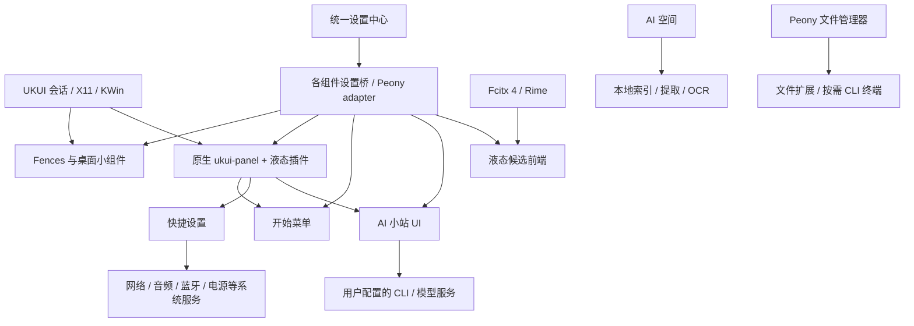

# Kylin-LQUI 应用框架与使用指南

面向首次拉取源码的使用者、构建者和维护者。本文按 2026-11-04 的源码整理；功能是否包含在当前 checkout 中，以 `git rev-parse HEAD` 和对应提交为准。各组件有自己的版本号，目前没有一个覆盖全部组件、全部发行版的统一安装包或一键安装器。

阅读顺序：本文 → [构建入口](BUILD.md) → 所需组件的使用说明。带日期的评审、性能和部署文档记录当时的环境与结果，不能直接当作当前机器的验收结论。

## 1. 框架提供什么

Kylin-LQUI 在 UKUI 系统能力上提供统一的桌面视觉和交互。用户可以分别安装组件，逐步启用桌面分区、液态任务栏、开始菜单、快捷设置、输入候选窗和 AI 工具。

| 组件 | 主要功能 | 运行边界 |
| --- | --- | --- |
| Fences 桌面 | 文件分区、图标与文字、固定/拖放、布局、壁纸、文件操作与撤回 | 独立桌面进程；保留原生桌面恢复路径 |
| 桌面小组件 | 系统监视、时钟与倒计时、活动统计、音乐、日历与待办 | 共用 Fences 进程；显示、自启动、记录开关分别管理 |
| 任务栏与 Dock | 原生任务区和托盘、固定应用、分组、布局、液态底板、日期/资源/AI 入口 | 样式插件加载进系统 `ukui-panel`，不是另起一套任务栏 |
| 开始菜单 | 应用分类、搜索、固定应用、最近项目、系统入口、Super 键唤起 | 独立进程，与任务栏开始按钮协作 |
| 统一设置中心 | 分类、搜索、卡片表单、模块状态、预览和帮助与恢复 | 独立 PyQt5 Widgets 程序；按需打开 |
| 快捷设置/系统控制中心 | Wi-Fi、蓝牙、音量与麦克风、亮度、电源、媒体和通知等快捷操作 | 与设置中心共用源码目录，但使用独立进程和系统后端 |
| AI 小站 | 文字/图片对话、草稿、线程恢复、停止、审批；支持 Codex 和 ACP 后台适配 | UI 与 CLI 模型进程分开；依赖用户自行安装并配置的 CLI |
| RIME 液态候选前端 | 候选排版、拼音、字体、玻璃外观和示例预览 | 连接 Fcitx 4 Kimpanel；Fcitx/Rime 仍承担输入与词库 |
| AI 空间 | 本地文件清单、正文提取、OCR、全文检索和 AIKB 知识库 | 独立应用与索引任务；不依赖启动 Fences |
| Peony 文件扩展 | 菜单与显示设置、扩展管理、复制路径、按需嵌入 CLI 终端、分类菜单排序和多窗口标签合并 | 插件运行在 Peony 中；完整旧管理器按需使用 WebEngine |

系统监视做本地采样，不调用模型诊断服务。AI 小站用于对话，AI 空间用于本地资料与知识库检索，二者的数据与进程独立。

## 2. 与系统的关系



框架继续使用 KWin、UKUI 会话管理、系统托盘协议、NetworkManager、BlueZ、音频与电源服务。安装 UI 组件不会安装或替换这些服务。快捷设置的声音实现需要 `pactl` 兼容接口；实际设备能力取决于系统后端。

常规模式保留原生 Peony 桌面作为兼容与恢复路径。“调试专用”中的桌面接管是有时限的试验，不等于已经提供可默认启用的永久登录接管。Wayland、其他桌面环境、其他 OEM 面板和显卡组合需要分别适配与验证。

## 3. 源码地图

以下路径均相对**统一仓库根目录**，即包含本仓库 `README.md`、`code-work/`、`peony-manager/` 的目录。

```text
Kylin-LQUI/
├── README.md / LICENSE / SECURITY.md
├── docs/                              整合、构建、评审与公开证据
├── tools/                             源码检查、文件发布事务与相关测试
├── code-work/
│   ├── ukui-liquid-desktop/
│   │   ├── apps/
│   │   │   ├── ukui-fences/            桌面、分区、小组件
│   │   │   ├── ukui-kaishicaidan-v2/   开始菜单
│   │   │   ├── ukui-panel-liquid/      任务栏插件与原生玻璃桥
│   │   │   └── kylin-lqui-settings/   设置中心、快捷设置、Peony adapter
│   │   ├── shared/                    材质、弹窗、设置协议、图标等
│   │   ├── integration/               状态清单、会话试验、模糊兼容
│   │   └── extras/                    可选硬件专项工具
│   ├── liquid-cli/                    AI 小站
│   ├── fcitx-liquid-panel/            候选窗前端
│   ├── shared/                        保留的兼容公共代码
│   └── ai-space/                      AI 空间与自己的运行资源
└── peony-manager/
    ├── app/                           设置、校验与管理器后端
    ├── plugins/                       Peony 插件 C++ 源码
    ├── helpers/                       系统安装助手源码
    └── tests/                         偏好、原生终端与生命周期测试
```

请克隆整个仓库，保留相对目录关系。主桌面公共材质与弹窗位于 `code-work/ukui-liquid-desktop/shared/`；AI 小站、候选前端的默认构建也引用这里。`code-work/shared/` 及一些组件内的历史副本不应被当成默认修改入口。AI 空间当前使用纯色界面，通过主框架共享设置桥接，不因桥接而启用玻璃渲染。

公共 C++ 库通常静态链接进宿主。改了公共代码后，要重新构建、安装并重启所有受影响宿主；复制一次共享源码不会自动更新运行中的应用。

## 4. 环境与依赖

已重点验证的环境为银河麒麟 / UKUI、X11、ARM64、Qt 5.12。基础开发要求为 CMake 3.16+、C++17 编译器、Python 3.8+、匹配系统的 Qt 5 开发环境及 X11/OpenGL 头文件。这不是对所有 Linux 发行版的兼容承诺。

| 范围 | 所需能力 |
| --- | --- |
| C++ 组件 | Qt Core、Gui、Widgets、DBus，部分组件使用 Network、Test；Fences/AI 空间需要 Zlib |
| 桌面与面板 | X11、XCB、OpenGL；开始菜单另用 Xtst/XRecord；面板插件必须匹配宿主 ABI |
| 统一设置/快捷设置 | 系统 Python、PyQt5 Widgets/DBus、PyGObject/Gio；系统功能还依赖对应服务和 GSettings schema |
| 候选前端 | Fcitx 4、Kimpanel、已安装并启用的 Rime；修改 Rime YAML 的工具需要 PyYAML |
| AI 小站/Peony CLI | 用户 systemd 会话及所需 CLI；账号登录由 CLI 自行管理 |
| AI 空间扩展提取 | PDF 使用 Poppler，OCR 使用 Tesseract 与语言包；缺失工具时部分格式受限 |
| Peony 原生扩展 | 匹配 Peony/Qt 的开发头文件、QTermWidget、utf8proc 和对应运行资源 |
| UI/集成测试 | Xvfb、xauth、私有会话 D-Bus；部分原生用例另需 xdotool、x11-utils、bubblewrap 等 |

发行版包名与 SDK 选项见[详细构建文档](../code-work/ukui-liquid-desktop/docs/BUILD.md)。仓库不包含开发机的 OEM SDK、构建缓存、CLI 登录状态或用户数据。缺少 Qt 开发包时，应自行准备 SDK 并通过 CMake 参数指定路径，不能照抄历史文档里的开发者绝对路径。

## 5. 获取与只读检查

```bash
git clone https://github.com/xikario/Kylin-LQUI.git
cd Kylin-LQUI
git rev-parse HEAD
python3 tools/check_workspace.py
python3 code-work/ukui-liquid-desktop/integration/desktop_status.py --json
```

源码检查只校验目录和 Python 语法，不代表所有模块已构建通过。状态工具读取本机进程、配置位置与服务状态，不主动启动组件；尚未安装的模块显示未运行是正常情况。

## 6. 独立构建组件

以下命令全部在**统一仓库根目录**执行，按需选用。采用安装脚本默认识别的构建目录，避免构建在一个位置、安装却读取另一个旧目录。

```bash
cmake -S code-work/ukui-liquid-desktop/apps/ukui-fences -B code-work/ukui-liquid-desktop/apps/ukui-fences/build -DCMAKE_BUILD_TYPE=Release
cmake --build code-work/ukui-liquid-desktop/apps/ukui-fences/build -j2

cmake -S code-work/ukui-liquid-desktop/apps/ukui-kaishicaidan-v2 -B code-work/ukui-liquid-desktop/apps/ukui-kaishicaidan-v2/build-v2 -DCMAKE_BUILD_TYPE=Release
cmake --build code-work/ukui-liquid-desktop/apps/ukui-kaishicaidan-v2/build-v2 -j2

cmake -S code-work/ukui-liquid-desktop/apps/ukui-panel-liquid -B code-work/ukui-liquid-desktop/apps/ukui-panel-liquid/build -DCMAKE_BUILD_TYPE=Release
cmake --build code-work/ukui-liquid-desktop/apps/ukui-panel-liquid/build -j2

cmake -S code-work/liquid-cli -B code-work/liquid-cli/build -DCMAKE_BUILD_TYPE=Release
cmake --build code-work/liquid-cli/build -j2

cmake -S code-work/fcitx-liquid-panel -B code-work/fcitx-liquid-panel/build -DCMAKE_BUILD_TYPE=Release
cmake --build code-work/fcitx-liquid-panel/build -j2

cmake -S code-work/ai-space -B code-work/ai-space/build -DCMAKE_BUILD_TYPE=Release
cmake --build code-work/ai-space/build -j2
```

设置中心本体无需 C++ 编译。任务栏构建会生成 `liblqui-glass-bridge.so`，供快捷设置的原生玻璃使用；缺失此库时设置安装器仍可工作，快捷设置使用降级材质。只改 Python 并安装，不能补齐尚未构建的原生桥。

Peony CLI 原生扩展提供独立构建入口。系统已安装匹配的 Qt 5、Peony、QTermWidget 开发/运行包、`pkg-config` 与 `moc` 后，在仓库根目录执行：

```bash
bash peony-manager/plugins/peony-cli-panel/build.sh
```

默认产物在插件目录的 `build/`，包含入口插件、终端运行库、会话 helper、依赖动态库及数据。需要其他输出目录时使用 `--output-dir`；使用外部解包 SDK 时可显式传入 `--sdk-root`，其目录布局和宿主 ABI 条件见 [Peony CLI 扩展说明](../peony-manager/plugins/peony-cli-panel/README.md)。脚本只构建，不安装依赖、不执行管理员授权，也不重启 Peony。

仓库不附带 `vendor/extract` SDK；部分原生集成测试仍使用该布局，需要按测试脚本准备外部依赖。源码构建、隔离测试、系统插件打包和管理员部署应分别验证，不能把构建完成当作扩展已生效。

## 7. 安装、启用与恢复

安装前先选定需要的组件。下面命令会修改用户安装目录、应用入口或自启动项；构建本身没有这些副作用。已有用户升级时先保存工作和设置草稿，备份配置，正常退出相关旧实例，再执行其安装流程。

| 组件 | 安装入口（仓库根目录执行） | 安装后的行为 |
| --- | --- | --- |
| Fences | `sh code-work/ukui-liquid-desktop/apps/ukui-fences/packaging/install-user.sh` | 安装到 `~/.local`，并写入用户自启动；默认读取本模块 `build/` |
| 开始菜单 | `cmake --install code-work/ukui-liquid-desktop/apps/ukui-kaishicaidan-v2/build-v2 --prefix "$HOME/.local"` | 安装程序和入口；基础安装不等于已接管原生菜单激活路由 |
| 任务栏 | `python3 code-work/ukui-liquid-desktop/apps/ukui-panel-liquid/scripts/install.py` | 发布用户插件/包装器、备份与自启动；不会立即替换运行中的面板 |
| AI 小站 | `python3 code-work/liquid-cli/scripts/install.py` | 发布版本目录、`current` 与入口；按照保存的登录常驻选项生成启动项 |
| 候选前端 | `python3 code-work/fcitx-liquid-panel/install-user.py` | 发布版本化前端和管理工具；首次启用另执行下方 `manage.py apply` |
| AI 空间 | `cmake --install code-work/ai-space/build --prefix "$HOME/.local"` | 安装应用和提取资源；登录启动在其设置中单独开启 |
| 统一设置/快捷设置 | `python3 code-work/ukui-liquid-desktop/apps/kylin-lqui-settings/install.py` | 发布 Python 程序、可用的玻璃桥和 Peony 管理资源；无用户覆盖时添加快捷设置预加载项 |

推荐先安装需要的原生模块，再安装设置中心，使其能读取新版设置协议。常用启动入口：

```bash
"$HOME/.local/bin/ukui-fences-launcher" --autostart
"$HOME/.local/bin/ukui-kaishicaidan-launcher" --autostart
"$HOME/.local/bin/ukui-panel-liquid-session"
"$HOME/.local/bin/kylin-lqui-settings"
"$HOME/.local/bin/liquid-cli" --show
"$HOME/.local/bin/ai-space" --show
```

首次启用液态候选前端，先在 Fcitx 中安装、添加并选择 Rime，再执行：

```bash
python3 "$HOME/.local/lib/fcitx-liquid-panel/current/manage.py" apply
```

管理工具会准备用户配置、接入 Kimpanel 和创建自启动。输入法设置中的候选数量、拼音选项可能更新 Rime 自定义 YAML 并请求重新部署；修改时应结束当前输入，保留工具生成的备份。更新候选窗前端不需要重启 Fcitx 引擎。

开始菜单接入原生自动激活还涉及用户 D-Bus service 和 autostart 路由，见[开始菜单说明](../code-work/ukui-liquid-desktop/apps/ukui-kaishicaidan-v2/README.md)。`packaging/install-menu-routing.py` 会改变这些入口，不能把它当成只读检查。

任务栏的 session 入口会尝试通过会话管理器切换单一面板。宿主 ABI 不匹配或加载失败时保留/恢复系统面板；不要直接覆盖系统面板二进制或重复启动第二个面板。完整恢复流程见[安装与恢复](../code-work/ukui-liquid-desktop/docs/INSTALL_AND_RESTORE.md)。

### Peony 的额外安装条件

Peony 普通配置使用当前用户的 GSettings/JSON。安装原生扩展需要系统级可信包和管理员认证。管理器检查的标准位置包括：

- 插件包载荷：`/usr/share/kylin-lqui/peony-plugins/`；
- 系统助手：`/usr/libexec/kylin-lqui/peony-manager-helper`；
- 实际扩展：发行版对应的 Peony extension 目录。

只有源码、没有上述系统载荷与助手时，“启用/安装扩展”不能完成部署。更新磁盘插件也不会替换现有 Peony 进程中已经加载的旧代码；应在文件任务和 CLI 会话结束后正常重开相关宿主。设置中心不自动批量关闭文件管理器窗口。

“菜单排序与标签合并”另提供独立的 `peony-window-tools` DEB，不使用上述 CLI 安装助手。在实际右键菜单中选择“自定义菜单顺序…”调整当前类型；“合并所有标签到此窗口”在验证标签打开成功后再关闭安全来源窗口，并保留存在嵌入终端会话的来源窗口。安装、兼容范围和边界见 [v1.1.0 更新说明](updates/peony-window-tools-v1.1.0.md)。

### 升级与回退的区别

设置中心、AI 小站和候选前端采用版本目录；任务栏有受管文件备份与恢复工具。Fences 的通用 `install-user.sh` 仍会直接安装文件、重写其自启动项，不提供同等级别的历史二进制事务。保留已有启动覆盖时，应先审阅安装计划并备份，不能假定所有安装器行为一致。

优先使用各模块的正常退出与恢复入口。任务栏可用 `~/.local/bin/ukui-panel-liquid-restore --restart`，候选前端可用已安装 `manage.py restore` 回到原生 UI，Fences/开始菜单可用各自 launcher 的 `--quit`。退出 AI 小站前等待回复结束；不要为了 UI 更新终止索引、Fcitx 引擎或 KWin。

`current`、`previous`、`install.json` 和安装备份用于定位旧版本。恢复程序版本与恢复用户数据是两件事，不应通过清空配置、聊天、索引或学习词库完成回退。

## 8. 日常设置与保存规则

统一设置中心负责呈现；各模块仍负责自己的配置校验和保存。C++ 模块通过 `org.kylin.Lqui.SettingsModule` 提供 `Catalog / Page / Set / Activate / Discard`，Peony 通过受限 adapter 访问自己的后端。设置中心不会再维护一套覆盖所有应用的平行配置。

| 场景 | 当前规则 |
| --- | --- |
| 导航 | 桌面分区归入“分区与布局”，相应组件归入“桌面小组件”；支持搜索和子级折叠 |
| 任务栏外观/日常交互 | 参数即时预览，连续滑动合并保存，避免每个移动事件都写配置 |
| AI 小站 | 外观与日常参数即时保存；后台、命令、工作目录、权限等变更需要“应用”；忙碌回复时阻止危险切换 |
| 输入法 | 参数变化更新示例预览，支持彩色/白/浅灰/深灰/黑五种背景；真正保存和 Rime 变更在“应用”后进行 |
| Peony 默认模型 | 默认 Codex 命令使用独立的 `peony-cli` profile；设置页与 CLI 内 `/model` 选好后按 Enter 保存同一份偏好，后续新会话沿用；按 s 仅本次会话，自定义命令保持原样 |
| 恢复默认 | 只恢复按钮文字与说明列明的字段；不同页面的作用范围不同，不等于清空所有个人数据 |
| 草稿/异步回执 | 编辑中内容、弹层与旧页面回包需要状态保护；不确定的未保存内容离页前会要求处理 |

输入法预览使用候选窗布局与绘制代码生成示例，不是抓取正在输入的私人文字。“模块未运行”时先点击页面提供的启动入口，再刷新；不能仅更新设置客户端、保留旧模块，就认为新字段已经生效。

Peony CLI 的独立模型保存在 `~/.codex/peony-cli.config.toml`，遵循已有 `CODEX_HOME`；不修改公共 `config.toml` 或账号认证。首次使用迁移旧 JSON 模型偏好，之后以独立 profile 为准。上述 `/model` 默认保存行为已用 Codex CLI 0.166.0 验证，临时会话选择不持久化；细节见 [Peony CLI 说明](../peony-manager/plugins/peony-cli-panel/README.md)。

## 9. 配置与数据位置

下面为默认用户路径，应用支持的 XDG 覆盖和用户自定义存储位置以实际设置为准。

| 数据 | 默认位置 |
| --- | --- |
| Fences 配置 / 布局 | `~/.config/kylin/ukui-fences.conf` / `~/.config/kyfences/layout.json` |
| 小组件/活动数据 | `~/.local/share/ukui-fences/widgets/`，包括 `activity.json` |
| 开始菜单 | `~/.config/ukui-kaishicaidan-v2/` |
| 任务栏外观 / 原生布局 | `~/.config/ukui/liquid-panel.ini` / `~/.config/ukui/panel.conf` |
| AI 小站配置 | `~/.config/liquid-cli/settings.json` |
| AI 小站聊天、草稿与附件 | `~/.local/share/liquid-cli/`，按后台保留会话 |
| 候选窗 / Rime 自定义配置 | `~/.config/fcitx/liquid-panel.conf` / `~/.config/fcitx/rime/` |
| Peony CLI 配置 | `~/.config/peony-manager/cli-profiles.json`；独立模型偏好为 `~/.codex/peony-cli.config.toml`（遵循已有 `CODEX_HOME`）；其余 Peony 选项使用 GSettings |
| Peony 分类菜单排序 | `~/.config/peony-manager/menu-order-contexts.json` |
| AI 空间配置 / 挂载库注册 | `~/.config/xikario/ai-space.ini` / `~/.config/ai-space/libraries.json` |
| AI 空间默认知识库 | `~/.local/share/ai-space/knowledge/`；新建库可选择其他存储盘 |
| 用户程序 / 版本化安装 | `~/.local/bin/` / `~/.local/lib/` |
| 用户登录启动 | `~/.config/autostart/` |

源码目录、构建目录、已安装程序与用户数据各有作用。删除 checkout 不等于卸载，重新克隆也不会重置已保存的设置。备份布局文件不会备份分区中实际引用的文件；迁移知识库需使用 AI 空间的导入/导出流程。

## 10. 材质、动画与资源

框架同时提供完整液态材质、默认不扭曲背景的任务栏纯玻璃，以及 CPU/磨砂回退。玻璃外观取决于组件、配置、背景对比度、GPU 与合成器；不能因存在 OpenGL 就认为所有表面都走 GPU。

- 背景来自壁纸缓存或打开前的区域快照；不是持续抓取所有下层窗口的实时光学模拟。
- 开始菜单、AI 小站和快捷设置具有从任务栏锚点推出/回收的打开关闭动画；减少动效设置和入口回退会改变表现。
- 候选窗按输入组合与几何变化复用材质；隐藏且无输入时不应继续抓屏/重建材质。
- 当前快捷设置的正式入口使用隐藏驻留模式，隐藏后停止轮询并释放场景，保留进程以改善再次打开速度。历史“60 秒空闲退出”记录不代表现版正式入口的行为。
- AI 小站 UI 常驻不表示模型常驻；消息按需启动后台，空闲休眠受用户设置控制。打开模型设置可能短暂启动目录查询进程，不会因此发送聊天消息。
- AI 空间的扫描/OCR、视频壁纸、音乐封面下载属于明确的活动负载，不能与静态隐藏窗口使用同一资源预期。

比较资源时使用相同配置与场景，记录进程树 PSS/SwapPSS、采样时长、CPU 口径、后台任务和窗口状态。单核 100% 与整机 CPU 百分比不同；含 WebEngine、CLI/MCP 子进程的应用应采进程树。文档中的短时性能数字只说明对应样本，不能视为新机器的固定预算或长期无泄漏证明。

## 11. 验证与问题反馈

轻量设置与偏好测试示例，在仓库根目录执行：

```bash
QT_QPA_PLATFORM=offscreen QT_SCALE_FACTOR=1 QT_AUTO_SCREEN_SCALE_FACTOR=0 QT_SCREEN_SCALE_FACTORS=1 python3 -m unittest discover -s code-work/ukui-liquid-desktop/apps/kylin-lqui-settings/tests -p 'test_ui*.py'
PYTHONPATH=peony-manager python3 -m unittest discover -s peony-manager/tests -p 'test_cli_settings.py'
```

原生测试先在各构建目录执行 `ctest -N`，再按改动选择用例。使用 `(cd 构建目录 && ctest …)` 的写法兼容较旧 CTest。UI、索引、文件操作和 OEM 宿主测试需要私有 Xvfb/D-Bus 与临时配置；不能把会改变配置的集成用例直接跑在工作桌面上。详见[测试说明](BUILD.md)和各模块测试文档。

人工验收至少覆盖：首次/再次打开、关闭和中途反向；下拉/子页/失焦；键盘操作；100%/150%/200% 缩放；滑条保存与重启；重复恢复默认；隐藏时材质计数；失败回退；聊天、布局和实际文件保留。GPU、CPU 回退、离屏测试与真实窗口映射分别记录，跳过的用例不能算通过。

反馈问题时提供提交号、系统/会话/架构、组件、最短复现步骤、预期与实际表现，以及脱敏的状态摘要。账号令牌、聊天、知识库正文、索引、Rime 学习记录、私人截图与原始日志不应提交到公开仓库，见 [安全与数据边界](../SECURITY.md)。

## 12. 进一步阅读与许可证

- [紧凑设置中心实施说明](COMPACT_SETTINGS_20261103.md)与[二轮评审](COMPACT_SETTINGS_REVIEW_20261104.md)。
- [历史 54 项评审追踪](REVIEW_REPAIR_20261101.md)与[交互、玻璃和资源记录](INTERACTION_PERFORMANCE_20261101.md)。
- [Fences](../code-work/ukui-liquid-desktop/apps/ukui-fences/README.md)、[开始菜单](../code-work/ukui-liquid-desktop/apps/ukui-kaishicaidan-v2/README.md)、[任务栏](../code-work/ukui-liquid-desktop/apps/ukui-panel-liquid/README.md)、[设置中心](../code-work/ukui-liquid-desktop/apps/kylin-lqui-settings/README.md)。
- [AI 小站](../code-work/liquid-cli/README.md)、[候选前端](../code-work/fcitx-liquid-panel/README.md)、[AI 空间](../code-work/ai-space/README.md)、[Peony 原生终端](../peony-manager/plugins/peony-cli-panel/README.md)。
- [组件清单](../code-work/ukui-liquid-desktop/integration/components.json)、[源码迁移说明](MIGRATION.md)、[第三方来源](../code-work/ukui-liquid-desktop/THIRD_PARTY_NOTICES.md)。

项目许可证见 [LICENSE](../LICENSE)。复用的 NextKde 材质、第三方库、词典和字体保留各自的署名及许可；分发时同时检查对应组件中的第三方说明。
